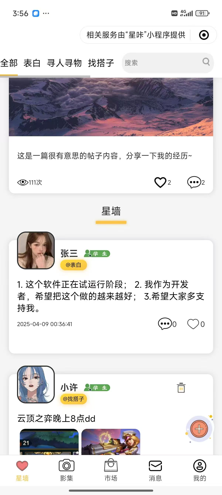
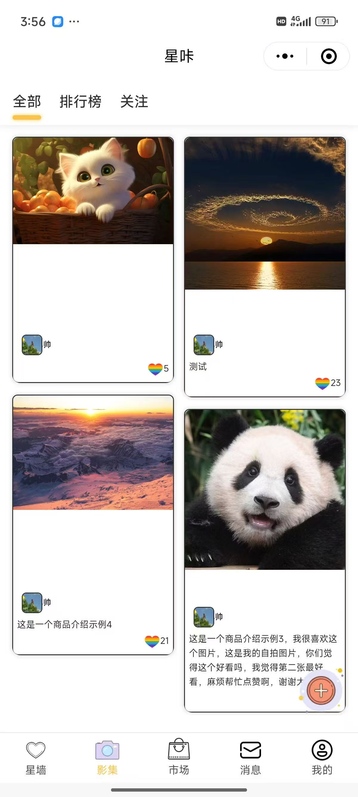
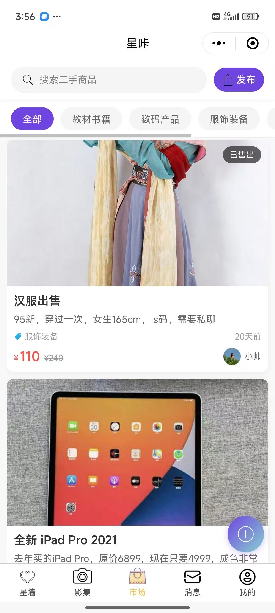
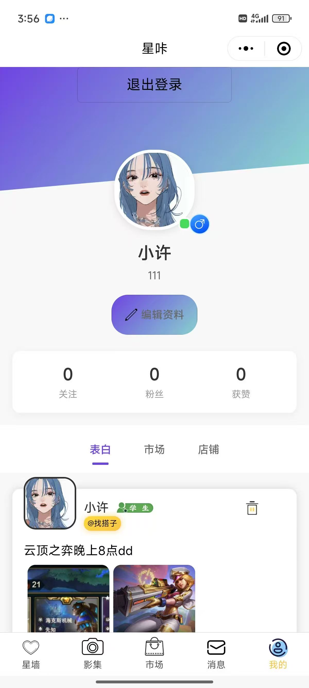
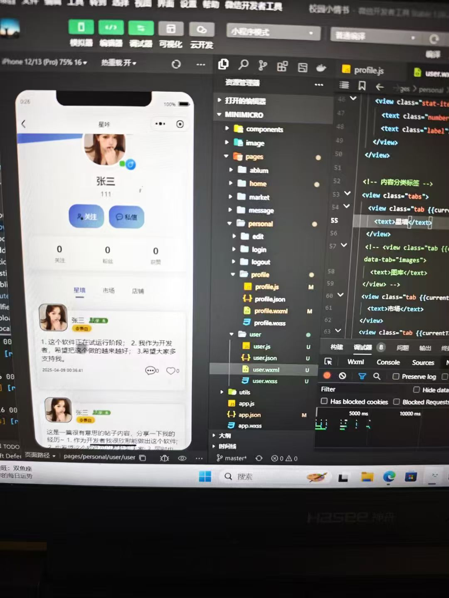
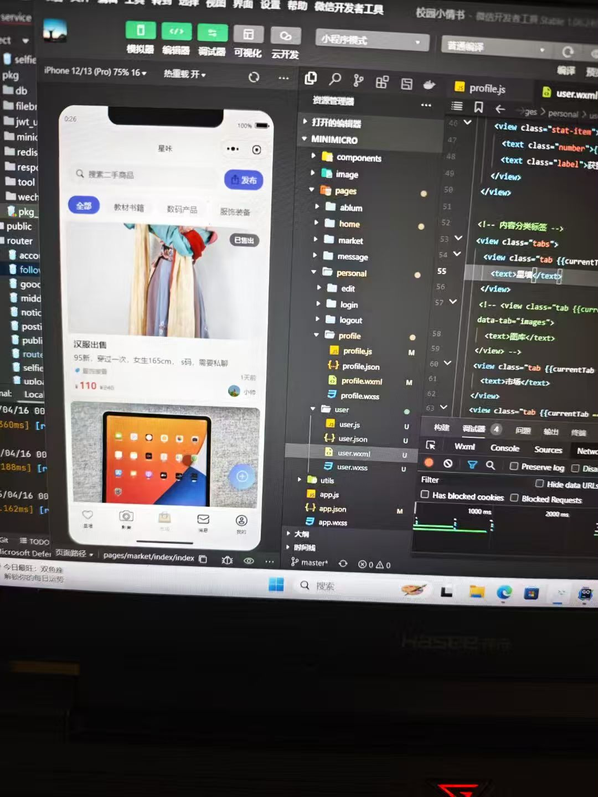
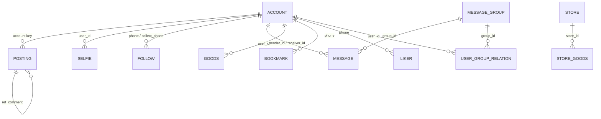

# LoveWall · Xingka

<div align="center">

**Campus confession wall · Photo album · Second-hand market · Private chat**

A campus social mini program built with **Go + the native WeChat Mini Program framework**

**English** · [简体中文](README.md)


</div>

---

## 📖 Introduction

LoveWall (named **Xingka / 星咔** inside the mini program, with the Go module named `shoollove`) is a social mini program for campus life. It puts a confession wall, a photo album, a second-hand market and private messaging into one app: post a confession on the Star Wall, look for someone or a study buddy, share everyday photos in the Album, sell unused items in the Market, and get to know new friends through follows and direct messages.

The repository has two parts:

- **`minimicro/`** — a native WeChat Mini Program (WXML / WXSS / JavaScript, no third-party UI framework)
- **`back_end/`** — a Go + Fiber backend providing REST APIs, JWT authentication, WebSocket messaging and image upload

The database is **PostgreSQL**. [`lovewall.sql`](lovewall.sql) is an early full backup of the database in PostgreSQL's custom archive format. **The PC admin panel has not been built yet** and is outside the current scope.

> **A regret**: because of the category and value-added service qualification requirements for personal-entity mini programs, this project never went live. It only runs in the development and trial builds. See “A Regret About Publishing” near the end.

---

## 🖼️ Showcase

> Screenshots were taken on a real device running the development build and inside WeChat DevTools.

| <br/><sub><b>Star Wall</b> · category feed and Today's Topic</sub> | <br/><sub><b>Album</b> · masonry grid and ranking</sub> |
| :---: | :---: |
| <br/><sub><b>Market</b> · second-hand goods and categories</sub> | <br/><sub><b>Me</b> · profile, stats and content tabs</sub> |
| <br/><sub><b>User profile</b> · follow, message and their posts</sub> | <br/><sub><b>In progress</b> · the market page in WeChat DevTools</sub> |

---

## ✨ Features

### 01 · Star Wall (the confession wall)

- **Five channels**: All / Confession / Lost & Found / Find a Buddy / Photo Feed, filtered by `posting.type` and searchable by keyword.
- **Today's Topic**: a pinned `notice` with cover image, title, content, views, likes and comment count.
- **Publishing**: text plus up to 3 images, chosen from the camera or the gallery.
- **Likes**: the set of user ids is stored in `posting.liker_id`, with like / unlike and a row of liker avatars.
- **Comment tree**: `posting.ref_comment` is a self-reference (main posts use `0`); replies can nest. The feed shows the three most-liked comments, while the detail view expands the whole tree.
- **Details**: student / admin / unverified badges, deleting your own posts, pull-to-refresh, pagination and tapping an avatar to visit the author's profile.

### 02 · Album (photo feed)

- **Two-column masonry**: the backend splits a page of results into `leftList` / `rightList` so the columns stay balanced.
- **Three tabs**: All / Ranking (by `like_num` descending) / Following (filtered by the `following` list).
- **Publishing**: images plus a caption; images are uploaded before the post is submitted.
- **Likes**: a colorful balloon animation on tap, an immediate like counter, and likes summed up on the profile page.

### 03 · Market (second-hand goods)

- **Categories**: All / Textbooks / Digital / Clothing / Daily necessities / Others.
- **Search**: by title and description.
- **Publishing**: cover image, title, description, current price, original price (optional) and category.
- **Cards**: cover, description, category, publish time, seller avatar and name, price with the struck-through original price, and a “Sold” badge.
- **Pagination**: server-side paging with pull-to-refresh and load-more.

### 04 · Messages and private chat

- **Following strip**: the people you follow are shown across the top of the message page; tap an avatar to open a chat.
- **Conversation list**: last message, relative time and an unread badge.
- **Chat page**: paginated history, left/right bubbles and automatic time separators after five minutes.
- **Real-time layer**: the backend exposes WebSocket `/ws` (live message forwarding) and `/push` (new-message push, with an in-memory online-client map). The mini program currently falls back to 3-second polling.
- **Read state**: an endpoint to clear unread messages.

### 05 · Accounts and profiles

- **Email sign-up**: `/public/send_code` generates a code, stores it in Redis and sends it over SMTP; `/public/register` verifies the code and exchanges the WeChat `js_code` for an `openid` via `jscode2session`.
- **Sign-in**: email + password; the server issues an HS256 JWT carrying `phone` as a claim.
- **Own profile**: cover, avatar, nickname, bio, gender, verification badge, and follower / following / like counts.
- **Other users' profiles**: follow / unfollow, a private-message entry and their Star Wall posts.
- **Edit profile**: avatar, nickname, bio and gender (UI is in place; the save endpoint can be completed further).
- **Sign-out**: clears local storage and returns to the Star Wall.

### 06 · Image upload

- The mini program uploads with `wx.uploadFile`; a `file_type` header specifies the extension.
- The backend renames the file with a UUID, forwards it to **FileBrowser** and returns the `fileName`.
- `/resource/img/:name` is a reverse proxy so the FileBrowser port is never exposed directly.
- Supports `png / jpg / jpeg / webp / gif`.

### 07 · Reserved for later

- WeChat Pay v3 prepay parameters, merchant certificate configuration and the `order` table (not connected to a checkout flow yet; certificate files must be supplied by you).
- Stores and store goods (`store`, `store_goods`).
- Group chat (`message_group`, `user_group_relation`).
- Bookmarks and like records (`bookmark`, `liker`).
- The “Market / Shop” tabs on the profile page.
- **PC admin panel** (moderation, user management, dashboards) — not built yet.

---

## 🏗️ Architecture

### Overview

```text
WeChat Mini Program  minimicro/
├── WXML · WXSS · JavaScript (native)
└── HTTPS /api/wechat/*   ·   WSS /ws, /push
        │
        ▼
Go backend  back_end/
├── Fiber v2 + GORM + JWT
├── router → handler → service → model
└── pkg (db / redis / jwt / filebrowser / wechat …)
        │
        ├── PostgreSQL   business data
        ├── Redis        sign-up codes
        ├── FileBrowser  image storage
        ├── SMTP         verification emails
        └── WeChat API   jscode2session / WeChat Pay v3
```

### Layers

| Layer | Directory | Responsibility |
| --- | --- | --- |
| Routing | `back_end/router` | Mounts business groups under `/api/wechat/*`, registers WebSocket endpoints and the static proxy; `middleware.go` provides the JWT guard |
| Handling | `back_end/handler` | Parses bodies / query parameters, calls services and returns the unified `{code, msg, data}` envelope via `respond.Ok` / `respond.Fail` |
| Business | `back_end/service` | Pagination, comment-tree assembly, likes, follow statistics and user aggregation |
| Data | `back_end/model` + `pkg/db` | GORM models, `SingularTable` naming, soft deletes, transactions and raw SQL |
| Infrastructure | `back_end/pkg` | Database, Redis, JWT, FileBrowser / MinIO, WeChat APIs, email, paging and type-conversion helpers |
| Configuration | `back_end/config` | Loads `config.yaml` from the working directory for the server, database, JWT, Redis, storage, email and mini program settings |

**Request path**: `utils/http.js` attaches `Authorization: Bearer <token>` → Fiber route → handler validation → service logic → GORM → PostgreSQL → unified response back to the mini program.

### Repository layout

```text
lovewall/
├── minimicro/                      # WeChat Mini Program
│   ├── pages/
│   │   ├── home/                   # Star Wall feed + composer
│   │   ├── ablum/                  # Album masonry + composer
│   │   ├── market/                 # Second-hand market + composer
│   │   ├── message/                # Conversations + chat
│   │   └── personal/               # Sign-in / sign-up / profile / edit / user page
│   ├── components/comment/         # Comment component
│   ├── image/                      # Icons and assets
│   ├── utils/                      # http / enum / util helpers
│   ├── config.js                   # Backend, image prefix and WebSocket URLs
│   └── app.json                    # Pages and the five-tab bar
├── back_end/                       # Go backend
│   ├── main.go                     # Entry: config → Redis → DB → router
│   ├── config/                     # YAML configuration loader
│   ├── router/                     # Routes and JWT middleware
│   ├── handler/                    # HTTP / WebSocket handlers
│   ├── service/                    # Business logic
│   ├── model/                      # GORM models
│   ├── enum/                       # Post types, goods categories, comment types
│   ├── pkg/                        # db / redis / jwt / filebrowser / wechat / tool / respond
│   ├── public/sql/                 # DDL for the extended tables
│   ├── cmd/                        # CRUD scaffolding and release scripts
│   ├── config.yaml                 # local config (placeholders; never commit real secrets)
│   └── go.mod
├── lovewall.sql                    # PostgreSQL full backup (custom archive format)
├── README.md / README.en.md        # Chinese / English docs
└── LICENSE
```

---

## 🧰 Tech Stack

| Area | Technology | Notes |
| --- | --- | --- |
| Client | Native WeChat Mini Program | WXML / WXSS / JavaScript; custom tab bar, two-column masonry, comment component |
| Web framework | [Fiber v2](https://gofiber.io/) | High-performance Go framework on fasthttp; route groups, `BodyParser` / `QueryParser` |
| Language | Go 1.23 | Module name `shoollove` |
| ORM | GORM 1.25 + gorm.io/gen | `SingularTable`, soft deletes, transactions, raw SQL, generated models |
| Database | PostgreSQL 15+ | MySQL is also supported by changing `database.driver` |
| Cache | Redis | Stores sign-up verification codes keyed by email |
| Auth | JWT HS256 | `golang-jwt/jwt/v5`; the `phone` claim is shared by HTTP and WebSocket |
| Real-time | WebSocket | `gofiber/contrib/websocket`; in-memory online-client map, `/ws` for chat and `/push` for pushes |
| File storage | FileBrowser (MinIO client reserved) | UUID names, type checks, reverse-proxied reads |
| Email | gomail.v2 | Sends verification codes over SMTP |
| WeChat APIs | jscode2session / WeChat Pay v3 | Exchanges `openid`; payments currently only have the parameter structures |
| Config | YAML | `config.yaml`, filled in with local environment values |
| Tooling | Bash + Go scripts | `cmd/bs_release.sh` scaffolds handler / model / router / service files |

---

## 🗄️ Database Design (lovewall.sql)

### About the backup

[`lovewall.sql`](lovewall.sql) is an early **PostgreSQL full backup** produced by `pg_dump -Fc` (custom archive format, magic header `PGDMP`, archive version 1.15). The database is `schoollove`, encoded as UTF-8, with a Simplified Chinese Windows locale.

It contains:

- **four core tables**: `account`, `notice`, `posting` and `selfie`;
- one `*_id_seq` sequence and one `*_pkey` primary key per table;
- full table and column comments;
- a small amount of sample data.

> ⚠️ This is not a plain-text SQL file. **`psql -f lovewall.sql` will not work** — use `pg_restore`.

```bash
# 1. Inspect the archive contents
pg_restore -l lovewall.sql

# 2. Create an empty database
createdb -h 127.0.0.1 -U postgres schoollove

# 3. Restore schema and data (--no-owner avoids missing-role errors)
pg_restore -h 127.0.0.1 -U postgres -d schoollove --no-owner lovewall.sql

# 4. Restore the schema only
pg_restore -h 127.0.0.1 -U postgres -d schoollove --schema-only --no-owner lovewall.sql
```

The dump was produced by PostgreSQL 15+ (it uses `LOCALE_PROVIDER = libc`), so restore it with PostgreSQL 15 or newer.

### Entity relationships



In plain text:

- `account` **1 : N** `posting` — linked by the account string (the current code uses `account.phone`; the equivalent column in the backup is `account.email`);
- `posting` **self-reference** — `ref_comment` points to the parent comment, forming the comment tree;
- `account` **1 : N** `selfie` — `selfie.user_id` → `account.id`;
- `account` **self-reference** — `follow.phone` follows `follow.collect_phone`;
- `account` **1 : N** `message` — `sender_id` sends to `receiver_id`; group messages use `group_id`;
- `message_group` **N : N** `account` — through `user_group_relation`;
- `store` **1 : N** `store_goods` — a store and its goods;
- `notice` is standalone.

### Core tables

#### account — user accounts

| Column | Type | Description |
| --- | --- | --- |
| `id` | `integer` | Primary key, generated from `account_id_seq` |
| `email` | `varchar(255)` | Sign-in account (commented as “phone”, but used as an email in code) |
| `password` | `varchar` | Password (hex-encoded on the client before transport / storage) |
| `name` | `varchar(20)` | Nickname |
| `sex` | `boolean` | Gender |
| `work` | `integer` | Step count |
| `openid` | `varchar(36)` | WeChat Mini Program `openid` |
| `authentication` | `boolean` | Verification status |
| `authentication_name` | `varchar(20)` | Verification role: student / admin |
| `authentication_etc` | `text` | Verification materials |
| `background_img` | `text` | Cover image (also shown as the bio on the profile page) |
| `following` | `integer` | Number of accounts followed, default `0` |
| `follower` | `integer` | Number of followers, default `0` |
| `avatar` | `text` | Avatar URL |
| `created_at` | `timestamp` | Created at |
| `updated_at` | `timestamp` | Updated at |
| `deleted_at` | `timestamp` | Soft-deleted at |

#### notice — announcements / Today's Topic

| Column | Type | Description |
| --- | --- | --- |
| `id` | `integer` | Primary key, auto-increment |
| `phone` | `varchar(11)` | Author account |
| `title` | `varchar(100)` | Title |
| `content` | `text` | Content |
| `attachments` | `text` | Attachment / cover image |
| `like_number` | `bigint` | Likes |
| `view_number` | `bigint` | Views |
| `comment_number` | `bigint` | Comments |
| `status` | `smallint` | Status |
| `created_at` | `timestamp` | Created at |
| `updated_at` | `timestamp` | Updated at |
| `deleted_at` | `timestamp` | Soft-deleted at |

#### posting — posts and comments

| Column | Type | Description |
| --- | --- | --- |
| `id` | `integer` | Primary key, auto-increment |
| `phone` | `varchar(11)` | Author account |
| `name` | `varchar(20)` | Author nickname (denormalized) |
| `avatar` | `varchar` | Author avatar (denormalized) |
| `authentication` | `boolean` | Whether verified (denormalized) |
| `authentication_name` | `varchar(20)` | Verification role (denormalized) |
| `type` | `smallint` | Post type: `0` all, `1` confession, `2` lost & found, `3` find a buddy, `4` photo feed |
| `like_people` | `text` | Liker ids, stored as a text list |
| `content` | `varchar(1000)` | Body |
| `photos` | `text` | Image URL list |
| `ref_comment` | `bigint` | Parent comment id; `0` means a top-level post |
| `created_at` | `timestamp` | Created at |
| `updated_at` | `timestamp` | Updated at |
| `deleted_at` | `timestamp` | Soft-deleted at |

#### selfie — album entries

| Column | Type | Description |
| --- | --- | --- |
| `id` | `integer` | Primary key, auto-increment |
| `phone` | `varchar(11)` | Publisher account |
| `user_id` | `integer` | Publisher user id |
| `like_num` | `integer` | Likes |
| `photos` | `text` | Image URL list |
| `created_at` | `timestamp` | Created at |
| `updated_at` | `timestamp` | Updated at |
| `deleted_at` | `timestamp` | Soft-deleted at |

### Extended tables

`lovewall.sql` only covers the four early core tables. As the market, follows, messaging and store features arrived, the schema continued to evolve in [`back_end/public/sql/`](back_end/public/sql) and in the GORM models:

| Table | Purpose | Key columns |
| --- | --- | --- |
| `follow` | Follow relationships | `phone` (follower), `collect_phone` (followed), `collect_id`, `user_id` |
| `bookmark` | Bookmarks | `phone`, `collect_id`, `type` |
| `liker` | Like records (reserved) | `phone`, `collect_id`, `type` |
| `message` | Direct / group messages | `sender_id`, `receiver_id`, `group_id`, `message_text`, `status`, `unread` |
| `message_group` | Chat groups | `create_user`, `create_phone`, `group_name` |
| `user_group_relation` | User ↔ group membership | `user_id`, `group_id` |
| `goods` | Second-hand goods | `title`, `description`, `images`, `category`, `price`, `original_price`, `status`, `user_id` |
| `store` | Campus stores | `phone`, `name`, `content`, `photos`, `price`, `status` |
| `store_goods` | Store products | `store_id`, `goods_name`, `price`, `status` |
| `order` | WeChat Pay orders (reserved) | `user_id`, `out_trade_no`, `total_fee`, `trade_type`, `product_id` |

> `order` is a SQL keyword — quote it when creating or querying it by hand. GORM does this automatically.

### Conventions and caveats

1. **Primary keys**: `integer` + sequence everywhere. GORM uses `SingularTable`, so table names are singular (`account`, not `accounts`).
2. **Soft deletes**: every core table has `deleted_at`; GORM's `gorm.DeletedAt` filters rows automatically, and `Unscoped()` is used for physical deletes.
3. **No foreign keys**: the dump only creates primary keys and sequences. Relationships are maintained in application code, which keeps early iteration fast but pushes consistency into the service layer.
4. **Text-encoded arrays**: `photos`, `like_people`, `liker_id` and `following` store comma-separated strings converted by helpers in `pkg/tool`. Simple, but awkward for database-level aggregation and joins.
5. **Denormalized counters**: `following`, `follower`, `like_num`, `view_number` and similar columns are incremented in place instead of being aggregated on read.
6. **Comment tree**: `posting.ref_comment` self-references the parent; top-level posts use `0`, and the tree is assembled recursively.
7. **Account identity**: the early backup stores the sign-in account in `account.email` (commented as “phone”), while the current code uses `account.phone`; `posting.phone`, `notice.phone` and `selfie.phone` store the account string, and `selfie.user_id` points to `account.id`. Keep this naming difference in mind when migrating or joining tables; `openid` binds the WeChat identity.
8. **Version drift**: `lovewall.sql` is a historical snapshot. The current code continues to evolve in the models and `public/sql` (for example `account.phone`, `posting.user_id` / `liker_id`, `selfie.title`). When creating or migrating a database, **treat the GORM models in `back_end/model` as the source of truth**.
9. **The extended DDL is early handwritten SQL**: some statements in `public/sql/*.sql` may miss semicolons or use a keyword as a table name. Review them against your target database before running.

### API overview

All routes live under `/api/wechat` and return `{ "code": bool, "msg": string, "data": any }`.

| Module | Method and path | Description |
| --- | --- | --- |
| Public | `POST /public/login`, `/register`, `/send_code`, `/check_code`, `/check_login` | Sign-in, sign-up, email codes, session check |
| Account | `POST /user/edit`, `/user/delete`; `GET /user/get`, `/user/form`, `/user/getbyid` | Profile updates and lookups |
| Star Wall | `POST /posting/add`, `/edit`, `/delete`, `/praise`; `GET /posting/get`, `/form`, `/get_comments` | Create, edit, delete, like, list / detail / comments |
| Topic | `POST /topic/add`, `/edit`, `/delete`; `GET /topic/get`, `/form`, `/praise` | Announcements / Today's Topic |
| Album | `POST /ablum/add`; `GET /ablum/get`, `/praise` | Publish, masonry list, like |
| Market | `POST /goods/add`, `/edit`, `/delete`; `GET /goods/get`, `/form` | Publish, edit, delete, list, detail |
| Follow | `POST /follow/add`, `/delete`; `GET /follow/get`, `/info`, `/follow_list` | Follow, unfollow, status, stats, list |
| Messages | `GET /message/unread_message`, `/get_message`; `POST /message/send_message`, `/clear_unread_message` | Conversations, history, send, read state |
| Images | `POST /images/upload`; `GET /images/delete/:name` | Upload and delete |
| Static | `GET /resource/img/:name` | FileBrowser image reverse proxy |
| WebSocket | `GET /ws`, `GET /push` | Chat transport and new-message pushes |

---

## 🚀 Getting Started

### 1. Prerequisites

- Go **1.23+**
- PostgreSQL **15+** (or MySQL 8 by changing `database.driver`)
- Redis **6+**
- FileBrowser (for image uploads; MinIO can replace it)
- A WeChat Mini Program AppID / AppSecret (for sign-up and sign-in)
- An SMTP mailbox (for verification codes)

### 2. Start the backend

```bash
cd back_end
# Edit config.yaml in the same directory and replace the placeholders
```

Fill in at least the following in `config.yaml`:

```yaml
server:
  port: 8000                 # listening port

database:
  driver: postgres
  user: postgres
  password: your-password
  addr: 127.0.0.1
  port: 5432
  dbname: schoollove
  zone: Asia/Shanghai

jwt:
  key: change-me             # JWT signing secret

redis:
  host: 127.0.0.1:6379
  password: ""
  database: 0

filebrowser:
  url: http://127.0.0.1:8080
  username: admin
  password: your-password
  bucket: schoollove
  share_id: your-share-id

email:
  host: smtp.qq.com
  port: 587
  name: your@qq.com
  password: your-smtp-code

miniprogram:
  appid: wx-your-appid
  appsecret: your-appsecret
```

Then run:

```bash
go mod tidy
go run main.go
```

> The `config.yaml` in this repository listens on `8000` by default; always follow the `server.port` you actually configured.

The server listens on `server.port` and exposes the API under `/api/wechat`. For production, build with `go build -o lovewall .` and run it behind systemd / Nginx.

### 3. Initialize the database

```bash
createdb schoollove
pg_restore -d schoollove --no-owner lovewall.sql
```

To use the market, follow and messaging modules, add the tables from [`back_end/public/sql/`](back_end/public/sql). Those files are early handwritten DDL — review them against your database before executing.

### 4. Run the mini program

1. Import the `minimicro/` directory in **WeChat DevTools**;
2. Put your own AppID into `project.config.json`;
3. Point `minimicro/config.js` at your backend:

   ```js
   const config = {
     dev: {
       domain: "http://127.0.0.1:8000/api/wechat",
       imageUrl: "http://127.0.0.1:8080/api/public/dl/your-share-id",
       wss: "ws://127.0.0.1:8000"
     },
     // ...
   }
   ```

4. During development, enable “Do not verify valid domain names, web-view domains, TLS versions and HTTPS certificates”;
5. For production, register the `request`, `uploadFile`, `downloadFile` and `socket` domains in the WeChat admin console and use HTTPS / WSS.

After starting, sign up with an email verification code, sign in, and try the Star Wall, Album, Market and messages.

---

## ⚠️ A Regret About Publishing

Every feature runs end to end in the **development and trial builds**, but the mini program never went live.

The reason is that personal-entity mini programs are restricted in both categories and qualifications: social / community capabilities require specific service categories, and some of them involve value-added service qualifications. An individual developer cannot meet those requirements, so the review could not pass. For a campus social product, this is the most regrettable part — it deserved to appear in more students' WeChat.

That is why the project is released as **open source** instead: it remains a complete, runnable and extensible codebase, and an honest record of the development process. If an appropriate company entity and qualifications become available, I will submit it for release right away.

Thanks to everyone who tried the trial build and shared feedback.

---

## 🧭 Known Limitations and Roadmap

**Known limitations**

- **No PC admin panel**: moderation, user management and report handling currently require direct database access.
- **WeChat Pay is not wired up**: only the prepay structures, certificates and `order` table exist; checkout and callbacks are missing.
- **Group chat is incomplete**: `message_group` and its relation table are modeled, but only direct messages are functional.
- **Message push is single-instance and in-memory**: online connections live inside the process; multi-instance deployments need Redis Pub/Sub.
- **No content safety**: WeChat `msgSecCheck`, reports, blocking and sensitive-word filters are absent.
- **Security practices need work**: the JWT middleware exists but is not mounted globally; passwords use reversible hex encoding instead of hashing; `config.yaml` now uses placeholders, but **never commit real database passwords, SMTP codes, WeChat secrets or merchant certificates** — use environment variables or a secret manager, and add `config.yaml` and `*.pem` to `.gitignore`; treat `filebrowser.share_id` as an access credential for the image directory and rotate it periodically.
- **Limited test coverage**: only a few tests exist for `pkg` and `service`.

**Roadmap**

- [ ] PC admin panel (moderation, users, dashboards)
- [ ] Complete mini program categories and qualifications, then publish
- [ ] WeChat Pay checkout, callbacks and order state machine
- [ ] Group chat, delivery reliability and multi-instance pushes
- [ ] Content safety (text / image moderation), reporting and blocking
- [ ] Password hashing, global JWT middleware, rate limiting
- [ ] Docker Compose for PostgreSQL + Redis + FileBrowser + backend
- [ ] Broader unit tests and CI

---

## 🤝 Contributing

Issues and pull requests are welcome:

1. Fork the repository;
2. Create a branch such as `feat/your-feature`;
3. Commit your changes with a clear message;
4. Open a pull request describing what changed and how it was verified.

Repository: <https://github.com/flairamos/lovewall>

## 📄 License

Released under the [MIT License](LICENSE), Copyright © 2025 xvwen.

## 🙏 Acknowledgements

Thanks to the WeChat Mini Program and Go communities for their excellent tooling, and to everyone who tried the development build and shared feedback. The project is still maturing — corrections are welcome.
