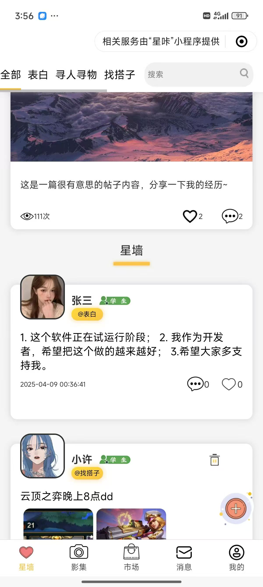
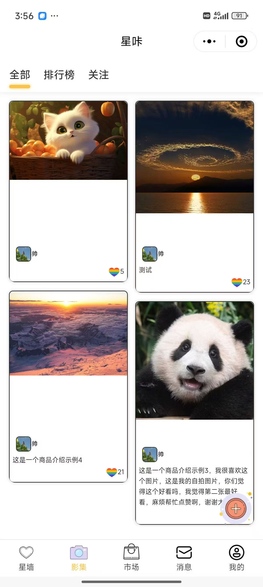
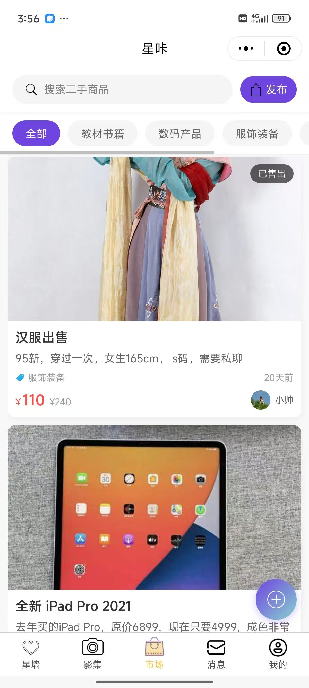
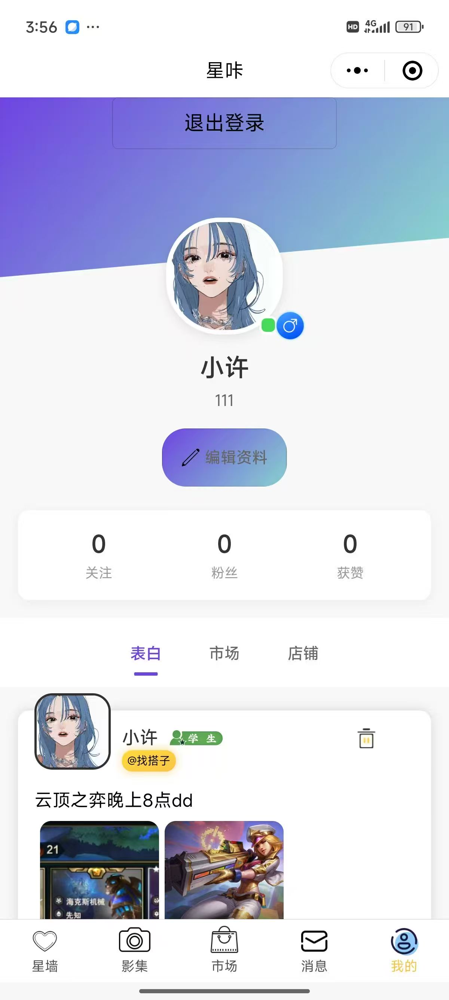
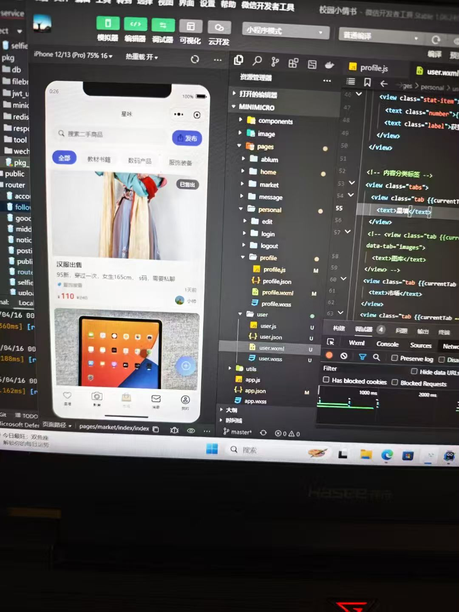
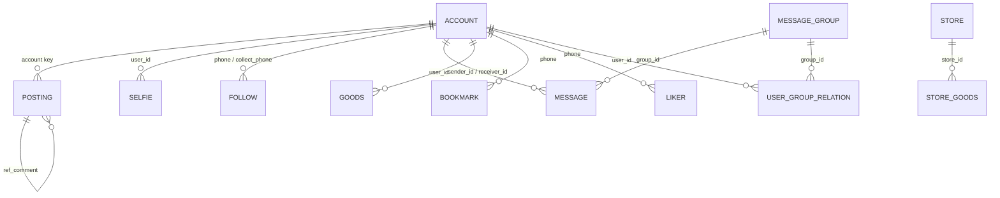

# LoveWall · 星咔

<div align="center">

**校园表白墙 · 影集 · 二手市场 · 私信**

一个用 **Go + 原生微信小程序** 写成的校园社交小项目

[English](README.en.md) · **简体中文**


</div>

---

## 📖 项目简介

LoveWall（小程序里叫「星咔」，后端模块名 `shoollove`）是一个面向校园场景的社交小程序。它把「表白墙」「影集」「二手市场」「私信」放进同一个应用：在星墙上发一条表白、找人、找搭子；在影集里晒出生活照片；把闲置物品挂到市场；再通过关注和私信认识新朋友。

项目由两部分组成：

- **`minimicro/`** —— 原生微信小程序（WXML / WXSS / JavaScript，无第三方 UI 框架）
- **`back_end/`** —— Go + Fiber 后端，提供 REST API、JWT 鉴权、WebSocket 私信与图片上传

数据库使用 **PostgreSQL**，[`lovewall.sql`](lovewall.sql) 是项目早期的全量备份（PostgreSQL 自定义归档格式）。**PC 管理端尚未开发**，暂不在当前项目范围内。

> **一个遗憾**：受个人主体小程序的类目与增值业务资质限制，这个小程序最终没能正式上架，只能在开发版 / 体验版中运行。详见文末「关于上架」。

---

## 🖼️ 项目展示

> 截图来自开发版真机与微信开发者工具。

| <br/><sub><b>星墙</b> · 分类信息流与今日话题</sub> | <br/><sub><b>影集</b> · 瀑布流与排行榜</sub> |
| :---: | :---: |
| <br/><sub><b>市场</b> · 二手好物与分类</sub> | <br/><sub><b>我的</b> · 主页、数据与内容 Tab</sub> |
| <br/><sub><b>用户主页</b> · 关注、私信与 TA 的星墙</sub> | <br/><sub><b>开发中</b> · 微信开发者工具里的市场页</sub> |

---

## ✨ 系统功能

### 01 · 星墙（表白墙）

- **五个频道**：全部 / 表白 / 寻人寻物 / 找搭子 / 美拍，按 `posting.type` 过滤，支持关键词搜索。
- **今日话题**：顶部展示 `notice` 公告的封面、标题、内容、浏览量、点赞数与评论数。
- **发帖**：文字 + 最多 3 张图片，支持拍照或从相册选择。
- **点赞**：用户 id 集合保存在 `posting.liker_id` 中，可点赞 / 取消点赞，并展示点赞人的头像。
- **评论树**：`posting.ref_comment` 自关联，主帖为 0，评论可继续回复；首页只取点赞最多的 3 条评论，详情页递归展开整棵树。
- **互动细节**：学生 / 管理员 / 未认证徽标、删除自己的帖子、下拉刷新、分页加载、点击头像进入用户主页。

### 02 · 影集（晒美图）

- **双列瀑布流**：后端把分页结果拆成 `leftList` / `rightList`，前端按列渲染，避免高度错位。
- **三个榜单**：全部 / 排行榜（按 `like_num` 倒序）/ 关注（按 `following` 里的用户过滤）。
- **发布**：图片 + 文案，图片先上传再提交。
- **点赞**：点击图片迸出彩色气球特效，点赞数即时 +1，并汇总到个人主页的「获赞」。

### 03 · 市场（二手市场）

- **分类浏览**：全部 / 教材书籍 / 数码产品 / 服饰装备 / 生活用品 / 其他。
- **搜索**：按标题、描述检索二手商品。
- **发布**：商品图片、标题、描述、现价、原价（选填）、分类。
- **商品卡片**：封面、描述、分类、发布时间、卖家头像与昵称、价格 / 划线原价，以及「已售出」状态。
- **分页**：服务端分页，支持下拉刷新与上拉加载。

### 04 · 消息与私信

- **关注的人**：消息页顶部横向展示关注列表，点头像直接进入聊天。
- **会话列表**：最后一条消息、相对时间、未读数角标。
- **聊天页**：历史消息分页、左右气泡、超过 5 分钟自动插入时间分隔。
- **实时能力**：后端提供 WebSocket `/ws`（在线消息转发）与 `/push`（新消息推送，内存维护在线连接表）；小程序端目前以 3 秒轮询作为兜底。
- **已读处理**：提供清空未读接口。

### 05 · 账户与个人主页

- **邮箱注册**：`/public/send_code` 生成验证码写入 Redis，再通过 SMTP 发信；`/public/register` 校验验证码，并用 `js_code` 调用微信 `jscode2session` 换取 `openid`。
- **登录**：邮箱 + 密码，服务端签发 HS256 JWT（claim 中携带 `phone`）。
- **个人主页**：头图、头像、昵称、个性签名、性别、认证角标，以及关注 / 粉丝 / 获赞三项数据。
- **他人主页**：关注 / 取关、私信入口，展示 TA 的星墙内容。
- **编辑资料**：头像、昵称、签名、性别（页面已具备交互，保存接口可继续完善）。
- **退出登录**：清空本地缓存并回到星墙。

### 06 · 图片上传

- 小程序通过 `wx.uploadFile` 上传，`file_type` 头指定扩展名。
- 后端用 UUID 重命名文件，转发到 **FileBrowser** 存储，返回 `fileName`。
- `/resource/img/:name` 做反向代理，避免直接暴露 FileBrowser 端口。
- 支持 `png / jpg / jpeg / webp / gif`。

### 07 · 已预留、待完善的能力

- 微信支付 v3 的 prepay 参数结构、商户证书配置与 `order` 表（尚未接入下单流程，证书文件需自行放置）。
- 店铺与店铺商品（`store`、`store_goods`）。
- 群聊（`message_group`、`user_group_relation`）。
- 收藏与点赞流水（`bookmark`、`liker`）。
- 个人主页的「市场 / 店铺」内容 Tab。
- **PC 管理端**（内容审核、用户管理、数据看板）—— 尚未开发。

---

## 🏗️ 项目架构

### 整体结构

```text
微信小程序  minimicro/
├── WXML · WXSS · JavaScript（原生）
└── HTTPS /api/wechat/*   ·   WSS /ws, /push
        │
        ▼
Go 后端  back_end/
├── Fiber v2 + GORM + JWT
├── router → handler → service → model
└── pkg（db / redis / jwt / filebrowser / wechat …）
        │
        ├── PostgreSQL   业务数据
        ├── Redis        注册验证码
        ├── FileBrowser  图片存储
        ├── SMTP         验证码邮件
        └── 微信接口      jscode2session / 微信支付 v3
```

### 分层说明

| 层 | 目录 | 职责 |
| --- | --- | --- |
| 路由层 | `back_end/router` | 按业务分组挂载 `/api/wechat/*`，注册 WebSocket 与静态资源代理；`middleware.go` 提供 JWT 校验中间件 |
| 处理层 | `back_end/handler` | 解析请求体 / 查询参数，调用 service，统一用 `respond.Ok` / `respond.Fail` 返回 `{code, msg, data}` |
| 业务层 | `back_end/service` | 分页、评论树组装、点赞、关注统计、用户信息聚合等业务逻辑 |
| 数据层 | `back_end/model` + `pkg/db` | GORM 模型、`SingularTable`（表名非复数）、软删除、事务与原生 SQL |
| 基础能力 | `back_end/pkg` | 数据库、Redis、JWT、FileBrowser / MinIO、微信接口、邮件、分页与类型转换工具 |
| 配置 | `back_end/config` | 读取同目录 `config.yaml`，覆盖服务、数据库、JWT、Redis、存储、邮件与小程序参数 |

**一次请求的路径**：小程序 `utils/http.js` 统一附加 `Authorization: Bearer <token>` → Fiber 路由 → handler 参数校验 → service 业务处理 → GORM 访问 PostgreSQL → 统一响应返回小程序。

### 仓库结构

```text
lovewall/
├── minimicro/                      # 微信小程序
│   ├── pages/
│   │   ├── home/                   # 星墙信息流 + 发帖
│   │   ├── ablum/                  # 影集瀑布流 + 发布
│   │   ├── market/                 # 二手市场 + 发布
│   │   ├── message/                # 会话列表 + 聊天
│   │   └── personal/               # 登录 / 注册 / 我的 / 编辑 / 用户主页
│   ├── components/comment/         # 评论组件
│   ├── image/                      # 图标与素材
│   ├── utils/                      # http / enum / util 封装
│   ├── config.js                   # 后端地址、图片前缀、WebSocket 地址
│   └── app.json                    # 页面注册与 5 个 tabBar
├── back_end/                       # Go 后端
│   ├── main.go                     # 启动入口：配置 → Redis → DB → 路由
│   ├── config/                     # YAML 配置加载
│   ├── router/                     # 路由与 JWT 中间件
│   ├── handler/                    # HTTP / WebSocket 处理器
│   ├── service/                    # 业务逻辑
│   ├── model/                      # GORM 模型
│   ├── enum/                       # 帖子类型、商品分类、评论类型
│   ├── pkg/                        # db / redis / jwt / filebrowser / wechat / tool / respond
│   ├── public/sql/                 # 扩展业务表的 DDL 脚本
│   ├── cmd/                        # CRUD 骨架生成脚本、发布脚本
│   ├── config.yaml                 # 本地配置（占位符，请勿提交真实密钥）
│   └── go.mod
├── lovewall.sql                    # PostgreSQL 全量备份（自定义归档格式）
├── README.md / README.en.md        # 中文 / 英文说明
└── LICENSE
```

---

## 🧰 技术栈

| 层次 | 技术 | 说明 |
| --- | --- | --- |
| 客户端 | 微信小程序原生框架 | WXML / WXSS / JavaScript，自定义 tabBar、双列瀑布流、评论组件 |
| Web 框架 | [Fiber v2](https://gofiber.io/) | 基于 fasthttp 的高性能 Go Web 框架，分组路由、`BodyParser` / `QueryParser` |
| 语言 | Go 1.23 | 模块名 `shoollove` |
| ORM | GORM 1.25 + gorm.io/gen | `SingularTable`、软删除、事务、原生 SQL、按表生成模型 |
| 数据库 | PostgreSQL 15+ | 通过 `database.driver` 也可切换 MySQL 驱动 |
| 缓存 | Redis | 保存注册验证码（以邮箱为 key） |
| 鉴权 | JWT HS256 | `golang-jwt/jwt/v5`，claim 携带 `phone`；HTTP 与 WebSocket 共用 |
| 实时通信 | WebSocket | `gofiber/contrib/websocket`，内存维护在线连接表，`/ws` 收发、`/push` 推送 |
| 文件存储 | FileBrowser（MinIO 客户端已预留） | UUID 重命名、类型校验、反向代理读取 |
| 邮件 | gomail.v2 | SMTP 发送注册验证码 |
| 微信能力 | jscode2session / 微信支付 v3 | 换取 `openid`；支付目前仅有参数结构 |
| 配置 | YAML | `config.yaml`，按模板填入本地环境参数 |
| 工程化 | Bash + Go 脚本 | `cmd/bs_release.sh` 生成 handler / model / router / service 骨架 |

---

## 🗄️ 数据库设计（lovewall.sql）

### 关于这个备份文件

[`lovewall.sql`](lovewall.sql) 是项目早期的 **PostgreSQL 全量备份**，由 `pg_dump -Fc` 生成（自定义归档格式，文件头为 `PGDMP`，归档版本 1.15），数据库名 `schoollove`，编码 UTF-8，排序规则为简体中文 Windows locale。

它包含：

- **4 张核心表**：`account`（账户）、`notice`（公告 / 话题）、`posting`（帖子与评论）、`selfie`（影集）；
- 每张表的 `*_id_seq` 序列、`*_pkey` 主键；
- 完整的表注释与字段注释；
- 少量示例数据。

> ⚠️ 这不是纯文本 SQL，**`psql -f lovewall.sql` 无法直接执行**，必须使用 `pg_restore`。

```bash
# 1. 查看归档中都包含什么
pg_restore -l lovewall.sql

# 2. 新建空库
createdb -h 127.0.0.1 -U postgres schoollove

# 3. 恢复结构与数据（--no-owner 可避免角色不存在的问题）
pg_restore -h 127.0.0.1 -U postgres -d schoollove --no-owner lovewall.sql

# 4. 只恢复表结构
pg_restore -h 127.0.0.1 -U postgres -d schoollove --schema-only --no-owner lovewall.sql
```

备份由 PostgreSQL 15+ 生成（使用了 `LOCALE_PROVIDER = libc` 语法），建议用 PostgreSQL 15 或更高版本恢复。

### 实体关系



文字版关系：

- `account` **1 : N** `posting` —— 通过账号字符串关联（当前代码为 `account.phone`，备份中同义列为 `account.email`）；
- `posting` **自关联** —— `ref_comment` 指向父评论，构成评论树；
- `account` **1 : N** `selfie` —— 通过 `selfie.user_id` → `account.id` 关联；
- `account` **自关联** —— `follow.phone` 关注 `follow.collect_phone`；
- `account` **1 : N** `message` —— `sender_id` 发送、`receiver_id` 接收，群聊走 `group_id`；
- `message_group` **N : N** `account` —— 通过 `user_group_relation` 关联；
- `store` **1 : N** `store_goods` —— 店铺与店内商品；
- `notice` 独立存在，不依赖其他表。

### 核心表结构

#### account · 账户表

| 字段 | 类型 | 说明 |
| --- | --- | --- |
| `id` | `integer` | 主键，`account_id_seq` 自增 |
| `email` | `varchar(255)` | 登录账号（注释写作「手机号」，代码中按邮箱使用） |
| `password` | `varchar` | 密码（客户端转十六进制后传输 / 存储） |
| `name` | `varchar(20)` | 昵称 |
| `sex` | `boolean` | 性别 |
| `work` | `integer` | 运动步数 |
| `openid` | `varchar(36)` | 微信小程序 `openid` |
| `authentication` | `boolean` | 认证状态 |
| `authentication_name` | `varchar(20)` | 认证信息：学生 / 管理员 |
| `authentication_etc` | `text` | 认证材料 |
| `background_img` | `text` | 背景图（个人主页中也作为个性签名展示） |
| `following` | `integer` | 关注数，默认 `0` |
| `follower` | `integer` | 粉丝数，默认 `0` |
| `avatar` | `text` | 头像地址 |
| `created_at` | `timestamp` | 创建时间 |
| `updated_at` | `timestamp` | 更新时间 |
| `deleted_at` | `timestamp` | 软删除时间 |

#### notice · 公告 / 今日话题表

| 字段 | 类型 | 说明 |
| --- | --- | --- |
| `id` | `integer` | 主键，自增 |
| `phone` | `varchar(11)` | 发布人账号 |
| `title` | `varchar(100)` | 标题 |
| `content` | `text` | 内容 |
| `attachments` | `text` | 附件 / 封面图 |
| `like_number` | `bigint` | 点赞数 |
| `view_number` | `bigint` | 浏览数 |
| `comment_number` | `bigint` | 评论数 |
| `status` | `smallint` | 状态 |
| `created_at` | `timestamp` | 创建时间 |
| `updated_at` | `timestamp` | 更新时间 |
| `deleted_at` | `timestamp` | 软删除时间 |

#### posting · 帖子 / 评论表

| 字段 | 类型 | 说明 |
| --- | --- | --- |
| `id` | `integer` | 主键，自增 |
| `phone` | `varchar(11)` | 作者账号 |
| `name` | `varchar(20)` | 作者昵称（冗余） |
| `avatar` | `varchar` | 作者头像（冗余） |
| `authentication` | `boolean` | 是否认证（冗余） |
| `authentication_name` | `varchar(20)` | 认证信息（冗余） |
| `type` | `smallint` | 帖子类型：`0` 全部、`1` 表白、`2` 寻人寻物、`3` 找搭子、`4` 美拍 |
| `like_people` | `text` | 点赞者集合（逗号分隔 / 文本数组） |
| `content` | `varchar(1000)` | 正文 |
| `photos` | `text` | 图片地址集合 |
| `ref_comment` | `bigint` | 父评论 id，`0` 表示主帖 |
| `created_at` | `timestamp` | 创建时间 |
| `updated_at` | `timestamp` | 更新时间 |
| `deleted_at` | `timestamp` | 软删除时间 |

#### selfie · 影集表

| 字段 | 类型 | 说明 |
| --- | --- | --- |
| `id` | `integer` | 主键，自增 |
| `phone` | `varchar(11)` | 发布者账号 |
| `user_id` | `integer` | 发布者用户 id |
| `like_num` | `integer` | 点赞数 |
| `photos` | `text` | 图片地址集合 |
| `created_at` | `timestamp` | 创建时间 |
| `updated_at` | `timestamp` | 更新时间 |
| `deleted_at` | `timestamp` | 软删除时间 |

### 扩展业务表

`lovewall.sql` 只覆盖项目早期的四张核心表。随着「二手市场 / 关注 / 私信 / 店铺」等功能加入，表结构继续在 [`back_end/public/sql/`](back_end/public/sql) 与 GORM 模型中演进：

| 表 | 用途 | 关键字段 |
| --- | --- | --- |
| `follow` | 关注关系 | `phone`（关注者）、`collect_phone`（被关注者）、`collect_id`、`user_id` |
| `bookmark` | 收藏流水 | `phone`、`collect_id`、`type` |
| `liker` | 点赞流水（预留） | `phone`、`collect_id`、`type` |
| `message` | 私信 / 群聊消息 | `sender_id`、`receiver_id`、`group_id`、`message_text`、`status`、`unread` |
| `message_group` | 群组 | `create_user`、`create_phone`、`group_name` |
| `user_group_relation` | 用户与群组关联 | `user_id`、`group_id` |
| `goods` | 二手商品 | `title`、`description`、`images`、`category`、`price`、`original_price`、`status`、`user_id` |
| `store` | 校园店铺 | `phone`、`name`、`content`、`photos`、`price`、`status` |
| `store_goods` | 店铺商品 | `store_id`、`goods_name`、`price`、`status` |
| `order` | 微信支付订单（预留） | `user_id`、`out_trade_no`、`total_fee`、`trade_type`、`product_id` |

> `order` 是 SQL 关键字，建表和查询时请加双引号（GORM 会自动处理）。

### 设计约定与注意事项

1. **主键**：统一使用 `integer` + `sequence` 自增；GORM 开启 `SingularTable`，因此表名是单数（`account` 而不是 `accounts`）。
2. **软删除**：所有核心表都有 `deleted_at`，GORM 使用 `gorm.DeletedAt` 自动过滤；需要物理删除时使用 `Unscoped()`。
3. **没有外键约束**：备份中只建立了主键与序列，关联关系全部由业务代码维护，便于早期快速迭代，但也意味着数据一致性需要应用层保证。
4. **数组字段以文本存储**：`photos`、`like_people`、`liker_id`、`following` 等字段保存逗号分隔的字符串，由 `pkg/tool` 中的转换函数读写；实现简单，但不便于数据库层统计与关联查询。
5. **计数冗余**：`following`、`follower`、`like_num`、`view_number` 等为冗余计数，更新时直接增减，避免实时聚合。
6. **评论树**：`posting.ref_comment` 自关联，主帖 `0`，通过递归查询组装树形结构。
7. **账号标识**：早期备份用 `account.email` 保存登录账号（注释写作「手机号」），当前代码改用 `account.phone`；`posting.phone`、`notice.phone`、`selfie.phone` 保存账号字符串，`selfie.user_id` 则指向 `account.id`。迁移或联表时要留意这层命名差异，`openid` 用于绑定微信身份。
8. **版本差异**：`lovewall.sql` 是历史快照，当前代码在模型与 `public/sql` 中继续演进（例如 `account.phone`、`posting.user_id` / `liker_id`、`selfie.title` 等字段）。新建数据库或做迁移时，**请以 `back_end/model` 中的 GORM 模型为准**。
9. **扩展 DDL 为早期手写脚本**：`public/sql/*.sql` 中的部分语句可能缺少分号或使用了关键字表名，实际执行前请按目标数据库校对。

### 接口一览

统一前缀 `/api/wechat`，响应格式 `{ "code": bool, "msg": string, "data": any }`。

| 模块 | 方法与路径 | 说明 |
| --- | --- | --- |
| 公共 | `POST /public/login`、`/register`、`/send_code`、`/check_code`、`/check_login` | 登录、注册、邮箱验证码、登录态检查 |
| 账户 | `POST /user/edit`、`/user/delete`；`GET /user/get`、`/user/form`、`/user/getbyid` | 资料修改、查询用户 |
| 星墙 | `POST /posting/add`、`/edit`、`/delete`、`/praise`；`GET /posting/get`、`/form`、`/get_comments` | 发帖、编辑、删除、点赞、列表 / 详情 / 评论 |
| 话题 | `POST /topic/add`、`/edit`、`/delete`；`GET /topic/get`、`/form`、`/praise` | 公告 / 今日话题 |
| 影集 | `POST /ablum/add`；`GET /ablum/get`、`/praise` | 发布、瀑布流列表、点赞 |
| 市场 | `POST /goods/add`、`/edit`、`/delete`；`GET /goods/get`、`/form` | 商品发布、编辑、删除、列表、详情 |
| 关注 | `POST /follow/add`、`/delete`；`GET /follow/get`、`/info`、`/follow_list` | 关注、取关、是否关注、统计、关注列表 |
| 消息 | `GET /message/unread_message`、`/get_message`；`POST /message/send_message`、`/clear_unread_message` | 会话、历史消息、发送、已读 |
| 图片 | `POST /images/upload`；`GET /images/delete/:name` | 上传、删除 |
| 静态资源 | `GET /resource/img/:name` | FileBrowser 图片反向代理 |
| WebSocket | `GET /ws`、`GET /push` | 聊天收发、新消息推送 |

---

## 🚀 快速开始

### 1. 准备环境

- Go **1.23+**
- PostgreSQL **15+**（或 MySQL 8，修改配置中的 `database.driver`）
- Redis **6+**
- FileBrowser（图片上传需要；也可替换为 MinIO）
- 微信小程序 AppID / AppSecret（注册登录需要）
- 一个可用的 SMTP 邮箱（验证码需要）

### 2. 启动后端

```bash
cd back_end
# 编辑同目录下的 config.yaml，把占位符替换为本地环境参数
```

编辑 `config.yaml`，至少填写：

```yaml
server:
  port: 8000                 # 监听端口，按需修改

database:
  driver: postgres
  user: postgres
  password: your-password
  addr: 127.0.0.1
  port: 5432
  dbname: schoollove
  zone: Asia/Shanghai

jwt:
  key: change-me             # JWT 签名密钥

redis:
  host: 127.0.0.1:6379
  password: ""
  database: 0

filebrowser:
  url: http://127.0.0.1:8080
  username: admin
  password: your-password
  bucket: schoollove
  share_id: your-share-id

email:
  host: smtp.qq.com
  port: 587
  name: your@qq.com
  password: your-smtp-code

miniprogram:
  appid: wx-your-appid
  appsecret: your-appsecret
```

然后运行：

```bash
go mod tidy
go run main.go
```

> 仓库中的 `config.yaml` 默认监听 `8000`，请以你实际配置的 `server.port` 为准。

启动后监听 `server.port`，接口前缀为 `/api/wechat`。生产环境建议 `go build -o lovewall .` 后配合 systemd / Nginx 运行。

### 3. 初始化数据库

```bash
createdb schoollove
pg_restore -d schoollove --no-owner lovewall.sql
```

如果还需使用二手市场、关注、私信等扩展模块，可按 [`back_end/public/sql/`](back_end/public/sql) 中的脚本补充建表；这些脚本是早期手写 DDL，请按实际数据库校对后再执行。

### 4. 运行小程序

1. 用 **微信开发者工具** 导入 `minimicro/` 目录；
2. 在 `project.config.json` 中填入自己的小程序 AppID；
3. 修改 `minimicro/config.js` 中的后端地址：

   ```js
   const config = {
     dev: {
       domain: "http://127.0.0.1:8000/api/wechat",
       imageUrl: "http://127.0.0.1:8080/api/public/dl/your-share-id",
       wss: "ws://127.0.0.1:8000"
     },
     // ...
   }
   ```

4. 开发阶段勾选「不校验合法域名、web-view（业务域名）、TLS 版本以及 HTTPS 证书」；
5. 正式环境需在微信公众平台配置 `request`、`uploadFile`、`downloadFile`、`socket` 合法域名，并使用 HTTPS / WSS。

启动后先注册账号（邮箱验证码），再登录体验发帖、影集、市场与私信。

---

## ⚠️ 关于上架：一份遗憾

功能已经可以在**开发版 / 体验版**中完整跑通，但这个小程序最终没有正式上架。

原因是个人主体的小程序在类目与资质上受到限制：社交 / 社区类能力需要相应的服务类目，而部分能力还涉及增值业务资质。个人开发者无法满足这些条件，提交审核也就无法通过。作为一个校园社交产品，这是它最遗憾的地方——它本可以出现在更多同学的微信里。

因此，项目选择以**开源**的方式和大家见面：它仍然是一份完整的、可以运行、可以继续扩展的代码，也是一段真实的开发记录。如果未来有合适的企业主体与资质，我会第一时间把它送上正式环境。

感谢每一个在体验版里试用过它、给出建议的朋友。

---

## 🧭 已知限制与 Roadmap

**已知限制**

- **PC 管理端尚未开发**：内容审核、用户管理、举报处理目前只能直接操作数据库。
- **微信支付未闭环**：只保留了 prepay 参数结构、证书与 `order` 表，未接入前端下单与回调。
- **群聊未完成**：`message_group` 与关联表已建模，当前主要跑通私信。
- **消息推送为单机内存实现**：在线连接保存在进程内，多实例部署需要换成 Redis Pub/Sub。
- **内容安全能力缺失**：未接入微信 `msgSecCheck`，也没有举报、拉黑、敏感词过滤。
- **安全实践需要加强**：JWT 中间件已实现但未全局挂载；密码使用可逆的十六进制编码而非哈希；仓库中的 `config.yaml` 已使用占位符，**请勿提交真实的数据库密码、SMTP 授权码、微信密钥与商户证书**，建议改用环境变量或密钥管理，并把 `config.yaml`、`*.pem` 加入 `.gitignore`；`filebrowser.share_id` 等同于图片目录的访问凭据，请定期轮换。
- **测试覆盖有限**：目前只有少量 `pkg` 与 `service` 测试。

**Roadmap**

- [ ] PC 管理端（内容审核、用户管理、数据看板）
- [ ] 补齐小程序类目与资质，正式上架
- [ ] 微信支付下单、回调与订单状态机
- [ ] 群聊、消息可靠性与多实例推送
- [ ] 内容安全（文本 / 图片审核）、举报与拉黑
- [ ] 密码哈希、JWT 全局中间件、接口限流
- [ ] Docker Compose 一键启动（PostgreSQL + Redis + FileBrowser + 后端）
- [ ] 更完整的单元测试与 CI

---

## 🤝 参与贡献

欢迎提 Issue 或 PR：

1. Fork 本仓库；
2. 新建分支 `feat/your-feature`；
3. 提交修改并保持 commit 信息清晰；
4. 发起 Pull Request，说明改动内容与验证方式。

仓库地址：<https://github.com/flairamos/lovewall>

## 📄 License

本项目基于 [MIT License](LICENSE) 开源，Copyright © 2025 xvwen。

## 🙏 致谢

感谢微信小程序与 Go 社区提供的优秀工具；也感谢每一个在开发版里试用、提出建议的朋友。项目仍有不成熟之处，欢迎指正。
